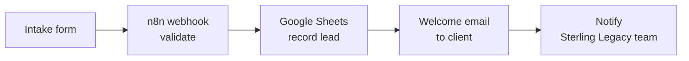

# Sterling Legacy Law: Landing Page & Intake Form

A landing page for a **fictional** estate planning and probate firm, built as a portfolio demo of
a legal client-intake automation: **website form → n8n → Google Sheets → welcome email → team notification**.

Built with Next.js 16 (App Router), React 19, Tailwind CSS v4, and TypeScript. It has no other runtime dependencies.

## The workflow

1. **Client submits the intake form.** The site checks the input and sends it to the n8n webhook.
2. **n8n validates the submission.** It checks the secret header and the required fields.
3. **The lead is recorded in Google Sheets.** One row per inquiry.
4. **The client receives a welcome email.** It uses a pre-approved template, personalized with their name and inquiry type.
5. **The Sterling Legacy team is notified.** "New lead received; follow-up may be needed."



This repository contains the website, which covers step 1. Steps 2–5 run in n8n.

## Run it

```bash
npm install
npm run dev   # http://localhost:3000
```

## How submission works

```
IntakeForm (client)  →  POST /api/intake (Next.js route)  →  N8N_WEBHOOK_URL
```

| File                                   | Role                                                                                        |
| -------------------------------------- | ------------------------------------------------------------------------------------------- |
| `src/components/intake/IntakeForm.tsx` | UI and state only. Calls `submitIntake()`.                                                  |
| `src/lib/intake/submitIntake.ts`       | Browser helper that posts to `/api/intake`.                                                 |
| `src/app/api/intake/route.ts`          | Re-validates input, checks the honeypot, picks demo or live mode, and forwards the payload. |
| `src/lib/intake/forwardToWebhook.ts`   | Builds the payload and posts it to n8n with the secret header.                              |
| `src/lib/intake/validate.ts`           | Validation shared by the browser and the server.                                            |

- **The webhook URL is server-side only.** It is never included in the browser bundle, so the browser never contacts n8n directly and no CORS setup is needed.
- **Demo mode:** if `N8N_WEBHOOK_URL` is empty, the API returns `{ status: "demo" }` and the page shows a
  **"Demo submission"** label that says the inquiry was _not sent anywhere_.
- **Live success** is shown only when n8n answers with a 2xx. Timeouts, non-2xx responses, and network errors show
  an inline error and keep everything the user typed.
- **Duplicate protection:** the button is disabled while sending, and an in-flight guard ignores extra clicks and
  Enter presses. Each inquiry has a `submissionId` that stays the same on retries, so n8n can de-duplicate.

### Payload sent to n8n

```json
{
  "submissionId": "57e6ffe4-4851-45e1-9c70-04ad2a799f14",
  "submittedAt": "2026-10-12T17:08:39.158Z",
  "fullName": "Eleanor Whitfield",
  "email": "eleanor.whitfield@example.com",
  "phone": "(555) 014-2290",
  "phoneE164": "+15550142290",
  "helpType": "Will or trust",
  "helpTypeKey": "will_or_trust",
  "contactMethod": "email",
  "description": "I'd like to update my will after recently moving states.",
  "source": "sterling-legacy-law-landing",
  "pageUrl": "http://localhost:3000/#intake"
}
```

`phone` is always US format `(000) 000-0000` (or empty). `helpTypeKey` is one of `estate_planning`, `will_or_trust`, `probate`, `power_of_attorney`, `other`.

## n8n setup

### Environment variables (`.env`)

```bash
N8N_WEBHOOK_URL=https://your-n8n-host/webhook/your-id
N8N_WEBHOOK_SECRET='your-secret'               # the Header Auth credential's Value
N8N_WEBHOOK_SECRET_HEADER=x-your-header-name   # the credential's Name (default: X-Intake-Secret)
```

- These are read on the server only and never reach the browser.
- **Wrap the secret in single quotes.** An unquoted `#` starts a comment in `.env` files, which silently cuts the secret short, and n8n then rejects it with a 403.
- Restart `npm run dev` after editing `.env`.

### Workflow nodes

1. **Webhook:** method `POST`, Header Auth credential matching the variables above. The `/webhook/` (Production) URL only responds while the workflow is **active**.
2. **Validate:** check that the required fields (`fullName`, `email`, `helpTypeKey`) are present.
3. **Google Sheets → Append row:** map the payload fields to columns. The payload is flat on purpose.
4. **Send welcome email:** address it to `{{$json.email}}` and personalize it with `fullName` and `helpType`.
5. **Notify the team:** "New lead received; follow-up may be needed", with the lead's details.

### Troubleshooting

The terminal running `npm run dev` logs the n8n response:

| Log                                   | Meaning                                                           |
| ------------------------------------- | ----------------------------------------------------------------- |
| `webhook responded 403`               | The header name or secret value doesn't match the n8n credential. |
| `webhook responded 404`               | The workflow isn't active, or the URL is wrong.                   |
| `demo mode — N8N_WEBHOOK_URL not set` | `.env` isn't being read. Check the file name and restart.         |

## Demo test data (fictional)

| Field            | Value                                                    |
| ---------------- | -------------------------------------------------------- |
| Full name        | Eleanor Whitfield                                        |
| Email            | eleanor.whitfield@example.com                            |
| Phone            | (555) 014-2290                                           |
| How can we help? | Will or trust                                            |
| Contact method   | Email                                                    |
| Description      | I'd like to update my will after recently moving states. |

---

Photos: Unsplash (free license). This is a portfolio demonstration, not a real law firm, and nothing on it is legal advice.
